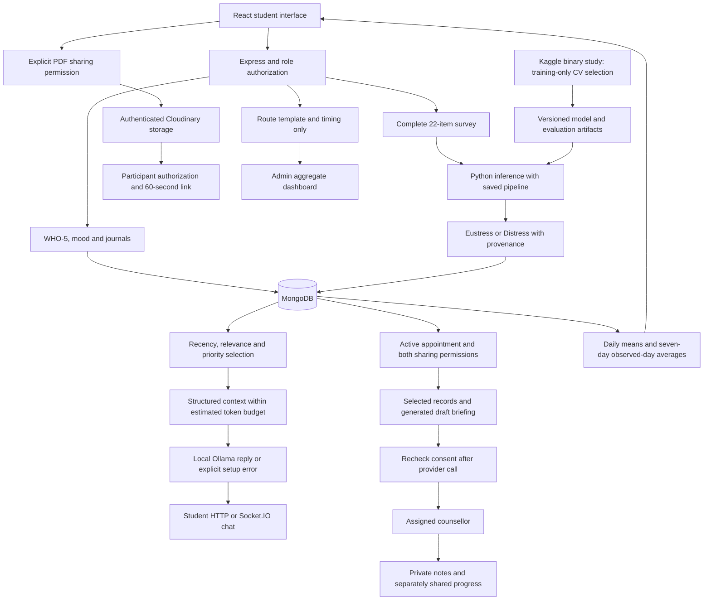

# Implemented research architecture

The classifier uses the separate survey; WHO-5/mood/journals do not become fabricated Kaggle features. The binary study excludes No Stress and cannot predict that class. Model output is not clinical severity. Context estimation measures the rendered context prompt, not total provider billing tokens.

Training and authored context evaluation are offline research workflows. Live AI/storage require configured provider accounts. Admin account-management APIs may expose identity for administration; the analytics overview excludes named wellness records. Private counselling notes and student-shared progress are different fields.

This text diagram reflects the implementation. Incorporate it into the original Word synopsis's architecture figure when completing its visual review.
